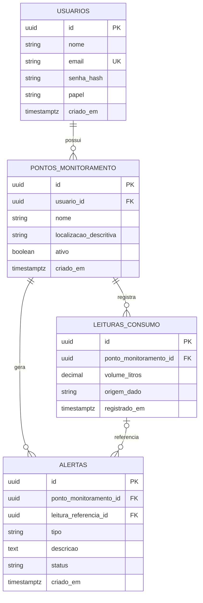

# ÁguaSmart — Sistema Inteligente de Monitoramento de Água

Documento de Especificação de Sistema (Spec Inicial)  
Fase 1 — Planejamento Orientado por Especificação (Spec-Driven Development)  
Estudante: Andrey Iago Costa Carvalho (3º ano A — Curso Técnico em Informática Integrado ao Ensino Médio)  
Instituição: Instituto Federal de Rondônia (IFRO) — Campus Porto Velho Calama  
Componente Curricular: Desenvolvimento de Sistemas | Docente: Rafael Pitwak  

---

## 1. Objetivo

O ÁguaSmart é uma plataforma digital concebida para mitigar o desperdício de água potável e evitar prejuízos financeiros decorrentes de vazamentos ocultos e consumos excessivos não percebidos no dia a dia. Destinado principalmente a moradores de residências, síndicos de condomínios e gestores de pequenos estabelecimentos comerciais, o sistema oferece uma solução acessível e intuitiva para usuários sem conhecimentos técnicos especializados. Como protótipo acadêmico funcional, o sistema permite acompanhar o volume de consumo por ponto de monitoramento, consultar o histórico cronológico de medições e identificar precocemente comportamentos anormais — como fluxo contínuo durante a madrugada ou picos atípicos em relação à média habitual —, emitindo alertas preventivos aos responsáveis antes da chegada da fatura mensal.

---

## 2. Usuários

O sistema possui dois tipos de usuários bem definidos, com controle de acesso e permissões segregados no servidor:

### 2.1 Usuário Cadastrado (Cliente / Consumidor)
* **Perfil:** Morador residencial, síndico/administrador de condomínio ou responsável por pequeno comércio que busca monitorar o consumo hídrico de seus imóveis ou setores.
* **Permissões e Ações Permitidas:**
  * Realizar auto-cadastro no sistema informando nome, e-mail e senha.
  * Realizar login e encerramento de sessão (logout).
  * Cadastrar, visualizar, editar a descrição e inativar seus próprios pontos de monitoramento de água.
  * Registrar leituras de consumo manuais e acionar a geração de leituras simuladas de demonstração associadas aos seus pontos.
  * Visualizar o painel analítico consolidado (consumo diário, semanal e mensal) de seus pontos de monitoramento.
  * Consultar e filtrar o histórico cronológico de leituras cadastradas para seus pontos.
  * Visualizar os alertas gerados para os seus pontos de monitoramento e alterar seus status operacionais (marcar como lido, reconhecido ou resolvido).
* **Restrições Estritas:**
  * Não possui permissão para visualizar, editar ou excluir pontos, leituras ou alertas pertencentes a outros usuários (isolamento rígido por identificador de usuário).
  * Não possui permissão para acessar rotas, telas ou APIs administrativas do sistema, sendo bloqueado no servidor caso tente alterar a URL ou enviar requisições diretas.

### 2.2 Administrador do Sistema
* **Perfil:** Responsável técnico ou operacional pela administração da plataforma e manutenção do serviço.
* **Permissões e Ações Permitidas:**
  * Realizar autenticação e logout em rota administrativa com credenciais privilegiadas (`papel = 'administrador'`).
  * Visualizar painel administrativo consolidado com métricas operacionais globais do sistema: contagem total de usuários ativos, total de pontos de monitoramento cadastrados, contagem agregada de leituras e total de alertas emitidos.
  * Consultar a lista de contas de usuários para suporte operacional e gerenciamento de status de acesso (ativação ou suspensão de conta).
* **Restrições Estritas:**
  * Não possui acesso desnecessário nem visualização a dados pessoais protegidos (como senhas, que são criptografadas de forma irreversível).
  * O acesso é controlado estritamente no servidor através de validação de papéis em middleware e funções de backend, impedindo elevação indevida de privilégios.

---

## 3. Casos de uso principais

A tabela a seguir apresenta os casos de uso centrais do ÁguaSmart, identificando os atores, o resultado esperado de cada ação e a rastreabilidade com os requisitos funcionais correspondentes:

| Identificador | Nome do Caso de Uso | Ator Principal | Descrição do Resultado Esperado | Requisitos Funcionais Relacionados |
| :--- | :--- | :--- | :--- | :--- |
| **UC01** | Cadastrar Usuário | Visitante (Não autenticado) | O visitante fornece nome, e-mail válido e senha; o sistema valida os dados no servidor, grava a senha com hash criptográfico e cria a conta com perfil comum. | RF01 |
| **UC02** | Autenticar e Encerrar Sessão | Usuário Cadastrado / Administrador | O usuário fornece e-mail e senha; o sistema confere o hash de autenticação, estabelece sessão segura e o direciona ao painel respectivo. No logout, encerra a sessão com invalidação de cookies/tokens. | RF02, RF03 |
| **UC03** | Gerenciar Pontos de Monitoramento | Usuário Cadastrado | O usuário cadastra um novo ponto de medição (ex.: "Cavalete Geral", "Cozinha"), edita sua localização descritiva ou altera seu status (ativo/inativo), mantendo o vínculo com sua conta. | RF04, RF05, RF12, RF13 |
| **UC04** | Registrar Leituras de Consumo | Usuário Cadastrado / Rotina de Demonstração | O usuário cadastra manualmente ou gera leituras simuladas de teste indicando volume em litros e data/hora, persistindo as informações com a origem claramente identificada. | RF06, RF12, RF13, RF15 |
| **UC05** | Consultar Painel de Consumo | Usuário Cadastrado | O usuário visualiza o consumo acumulado consolidado do dia, da semana e do mês para o ponto selecionado, com indicadores gráficos e comparativos simples. | RF07, RF13 |
| **UC06** | Consultar e Filtrar Histórico | Usuário Cadastrado | O usuário seleciona um ponto de monitoramento e define um intervalo de datas para obter a listagem paginada e cronológica de todas as medições registradas. | RF08, RF13 |
| **UC07** | Processar e Identificar Anomalias | Sistema (Automático) | O sistema avalia as leituras persistidas contra regras de detecção de anomalias (fluxo contínuo na madrugada e picos de 50% acima da média histórica), registrando alertas preventivos quando violadas. | RF09, RF10, RF12 |
| **UC08** | Visualizar e Gerenciar Alertas | Usuário Cadastrado | O usuário visualiza a lista de alertas emitidos para seus pontos, lê as instruções preventivas (ex.: inspecionar torneiras e descargas) e atualiza o status para "reconhecido" ou "resolvido". | RF10, RF11, RF13 |
| **UC09** | Administrar Operações da Plataforma | Administrador do Sistema | O administrador acessa a área administrativa restrita e acompanha as métricas globais agregadas de funcionamento do sistema com controle de permissões no servidor. | RF13, RF14 |

---

## 4. Requisitos funcionais

A lista a seguir enumera todos os comportamentos específicos e verificáveis que o sistema deve executar:

* **RF01 — Cadastro de Usuários:** O sistema deve permitir o cadastro de novos usuários mediante o fornecimento obrigatório de nome completo, e-mail e senha (mínimo de 8 caracteres). O sistema deve validar no servidor o formato do e-mail e garantir a unicidade de e-mail na base de dados, rejeitando duplicidades.
* **RF02 — Autenticação de Usuários (Login):** O sistema deve permitir a autenticação de usuários mediante validação de e-mail e conferência segura do hash da senha, iniciando uma sessão criptografada protegida e redirecionando o usuário para a interface condizente com seu papel.
* **RF03 — Encerramento de Sessão (Logout):** O sistema deve permitir que o usuário autenticado encerre sua sessão ativa a qualquer momento, invalidando o token ou cookie de sessão no servidor e redirecionando-o para a tela de login.
* **RF04 — Cadastro de Pontos de Monitoramento:** O sistema deve permitir que o usuário autenticado cadastre pontos de medição de água, informando obrigatoriamente um nome descritivo (ex.: "Cavalete Principal", "Reservatório Inferior"), localização descritiva opcional (ex.: "Entrada de serviço") e status de ativação, vinculando o registro de forma automática e imutável ao `usuario_id` autenticado.
* **RF05 — Edição e Inativação de Pontos de Monitoramento:** O sistema deve permitir ao usuário proprietário alterar o nome, a localização descritiva e o status (ativo ou inativo) de seus pontos de monitoramento.
* **RF06 — Registro e Persistência de Leituras de Consumo:** O sistema deve permitir o registro e a persistência no banco de dados de leituras de consumo de água, contendo obrigatoriamente: o identificador do ponto de monitoramento, o volume consumido em litros (valor numérico positivo com até duas casas decimais), a origem do dado (`"simulada_teste"`, `"manual"` ou `"sensor_iot"`) e o timestamp (data e hora) do registro.
* **RF07 — Consolidação de Consumo no Painel:** O sistema deve calcular e exibir em um painel interativo o consumo acumulado de água por ponto de monitoramento selecionado, apresentando métricas calculadas em três janelas temporais: consumo diário (últimas 24 horas), consumo semanal (últimos 7 dias) e consumo mensal (mês civil corrente).
* **RF08 — Consulta e Filtragem de Histórico:** O sistema deve permitir a consulta do histórico de leituras de um ponto de monitoramento com suporte a filtros por período (data inicial e data final), exibindo os resultados ordenados de forma decrescente por data/hora e com paginação de até 50 registros por página.
* **RF09 — Mecanismo de Detecção de Possíveis Anomalias:** O sistema deve executar regras determinísticas e automatizadas para identificar anomalias nas leituras registradas:
  * *Regra de Fluxo Noturno Contínuo:* Identificar leituras consecutivas com volume maior que zero registradas na faixa de horário da madrugada (entre 01:00 e 05:00) por período contínuo igual ou superior a 120 minutos (2 horas).
  * *Regra de Consumo Acima da Média:* Identificar quando o consumo consolidado em um dia exceder em 50% ou mais a média diária histórica calculada para aquele mesmo ponto nos últimos 7 dias.
* **RF10 — Registro Automático de Alertas:** O sistema deve criar automaticamente um registro de alerta na base de dados quando qualquer regra de anomalia do RF09 for atendida, contendo o ponto de monitoramento associado, a referência à leitura causadora (quando aplicável), o tipo da anomalia, uma mensagem orientativa com recomendação preventiva ao usuário e o status inicial definido como `"pendente"`.
* **RF11 — Consulta e Atualização de Status dos Alertas:** O sistema deve permitir que o usuário proprietário consulte a listagem de alertas dos seus pontos de monitoramento e altere o status de cada alerta entre as opções `"pendente"`, `"reconhecido"` e `"resolvido"`.
* **RF12 — Garantia de Integridade Referencial:** O sistema deve validar no servidor e no banco de dados que nenhuma leitura de consumo ou alerta seja persistido sem associação a um ponto de monitoramento previamente existente e válido.
* **RF13 — Isolamento Multiusuário dos Dados:** O sistema deve assegurar que todas as consultas e comandos de leitura, escrita e exclusão apliquem filtros no servidor com base no `usuario_id` da sessão ativa, impedindo que um usuário comum acesse ou manipule pontos, leituras ou alertas pertencentes a terceiros.
* **RF14 — Painel Operacional Administrativo:** O sistema deve disponibilizar uma interface restrita a usuários com o papel `"administrador"` para visualização de métricas agregadas da infraestrutura (quantidade total de usuários cadastrados, total de pontos de monitoramento, volume geral de medições e contagem de alertas pendentes), bloqueando sumariamente requisições de usuários comuns.
* **RF15 — Injeção de Dados de Demonstração (Massa de Testes Simulada):** O sistema deve fornecer um recurso para popular o histórico de um ponto de monitoramento com dados simulados de teste, identificados obrigatoriamente com a tag `origem_dado = "simulada_teste"`, viabilizando a validação de telas, gráficos e regras de anomalia durante avaliações acadêmicas sem necessidade de integração com sensor físico imediato.

---

## 5. Requisitos não funcionais

Os requisitos não funcionais definem os atributos de qualidade técnica, segurança, desempenho e manutenibilidade do sistema:

### Segurança
* **RNF01 — Criptografia e Armazenamento Seguro de Senhas:** Nenhuma senha de usuário deve ser armazenada em texto puro em qualquer circunstância; o sistema deve aplicar algoritmo de hash criptográfico seguro (bcrypt com fator de custo de no mínimo 10, ou argon2id) com geração de salt aleatório por credencial no momento da gravação.
* **RNF02 — Validação Obrigatória no Servidor:** Todas as requisições, entradas de formulários e parâmetros de API devem ser estritamente validados no servidor através de esquemas tipados (como Zod), mesmo quando já existirem validações visuais ou restrições via JavaScript no navegador do cliente.
* **RNF03 — Prevenção contra Injeção de SQL (SQL Injection):** Todas as consultas e operações com o banco de dados devem ser executadas exclusivamente através de consultas parametrizadas (*prepared statements*) fornecidas pelo Prisma ORM, proibindo concatenação direta de variáveis e strings de texto em instruções SQL.
* **RNF04 — Isolamento de Segredos e Credenciais em Variáveis de Ambiente:** Nenhuma chave de criptografia, segredo de sessão ou string de conexão com o banco de dados (`DATABASE_URL`) pode ser exposta no código-fonte ou enviada ao repositório Git; todos os valores sensíveis devem ser injetados exclusivamente por meio de variáveis de ambiente (`.env.local` em desenvolvimento e Vercel Environment Variables em produção).
* **RNF05 — Controle de Autorização Baseado em Papéis e Propriedade:** O controle de autorização deve ser executado no nível do servidor (middleware de rotas e verificações de posse de registro por `usuario_id`), garantindo que alterações manuais na URL do navegador ou disparos de API por ferramentas externas não permitam acesso a telas administrativas nem a dados de outros usuários.
* **RNF06 — Sanitização de Mensagens de Erro:** O sistema não deve expor mensagens de erro contendo detalhes internos da arquitetura, *stack traces*, consultas SQL ou nomes de colunas na interface do usuário final; em caso de falha operacional, o sistema deve registrar a falha em log interno seguro e apresentar ao usuário apenas uma mensagem amigável e genérica.
* **RNF07 — Comunicação Criptografada (HTTPS):** No ambiente de produção publicado, todo o tráfego entre cliente e servidor deve ser protegido obrigatoriamente por protocolo HTTPS com certificados TLS modernos gerenciados pela plataforma de hospedagem.

### Desempenho
* **RNF08 — Tempo-Alvo de Resposta:** O tempo de resposta de processamento no servidor para carregamento do painel e registro de leituras não deve ultrapassar 800 milissegundos em condições normais de teste, atingindo tempo total de exibição inferior a 1,5 segundos em conexões de banda larga convencionais.
* **RNF09 — Paginação de Grandes Conjuntos de Dados:** As consultas ao histórico de leituras devem limitar o volume de dados transferidos por meio de paginação no servidor com no máximo 50 registros por página, evitando sobrecarga de memória no banco e lentidão de renderização no navegador.

### Usabilidade e Acessibilidade
* **RNF10 — Responsividade Multiplataforma:** A interface gráfica deve ser responsiva e funcional tanto em navegadores de computadores desktop (resolução de 1280px ou superior) quanto em dispositivos móveis (smartphones com largura a partir de 360px).
* **RNF11 — Clareza Textual em Português Brasileiro:** Todos os textos da interface, rótulos de campos, mensagens de feedback, avisos de validação e textos de alertas devem ser redigidos em português brasileiro claro, sem jargões excessivos e com linguagem acessível ao público geral.
* **RNF12 — Estados da Interface (Feedback Visual):** A aplicação deve fornecer feedback visual imediato para todos os estados assíncronos: telas de carregamento (*spinners* ou *skeletons*), telas vazias com mensagens orientativas (*empty states*, ex.: "Nenhum ponto cadastrado ainda") e notificações visuais claras em caso de erros ou falhas de conexão.

### Confiabilidade e Manutenção
* **RNF13 — Tratamento Estruturado de Falhas de Banco:** O sistema deve capturar e tratar exceções de comunicação e indisponibilidade temporária do banco de dados na nuvem, retornando códigos de status HTTP semânticos (500/503) e impedindo que a aplicação trave ou fique em estado inconsistente.
* **RNF14 — Modularidade e Documentação de Instalação:** O código-fonte deve ser escrito em TypeScript, com estrutura modular e tipagem estrita, acompanhado de arquivo `README.md` com instruções detalhadas para configuração, instalação de dependências e execução do projeto no ambiente de desenvolvimento local.

### Privacidade e Minimização de Dados
* **RNF15 — Princípio da Minimização de Dados:** O sistema deve coletar estritamente as informações indispensáveis para a prestação do serviço (nome do responsável, e-mail para autenticação, identificação dos pontos e leituras de consumo), abstendo-se de coletar dados pessoais sensíveis, rastreamentos invasivos ou dados financeiros não relacionados ao protótipo.

---

## 6. Modelo de dados (DER simples)

O modelo relacional do ÁguaSmart foi desenhado para sustentar com robustez todos os requisitos funcionais, preservando a integridade referencial, o isolamento multiusuário e a rastreabilidade das medições.

### 6.1 Detalhamento das Entidades

#### Tabela `usuarios`
Armazena os dados cadastrais e as credenciais dos usuários da plataforma.
* `id` (UUID, Chave Primária, NOT NULL): Identificador único global do usuário.
* `nome` (VARCHAR(100), NOT NULL): Nome completo do usuário.
* `email` (VARCHAR(150), NOT NULL, UNIQUE): Endereço de e-mail utilizado para login e notificações.
* `senha_hash` (VARCHAR(255), NOT NULL): Hash criptográfico seguro da senha gerado com salt.
* `papel` (VARCHAR(20), NOT NULL, DEFAULT 'cliente'): Perfil de acesso do usuário (`'cliente'` ou `'administrador'`).
* `criado_em` (TIMESTAMPTZ, NOT NULL, DEFAULT NOW()): Data e hora de criação do registro no banco.

#### Tabela `pontos_monitoramento`
Armazena os pontos físicos ou lógicos onde a água é monitorada pelo usuário.
* `id` (UUID, Chave Primária, NOT NULL): Identificador único do ponto de monitoramento.
* `usuario_id` (UUID, Chave Estrangeira referenciando `usuarios.id`, NOT NULL): Dono do ponto de monitoramento.
* `nome` (VARCHAR(100), NOT NULL): Identificação amigável do ponto (ex.: "Cavalete Geral", "Cozinha", "Reservatório").
* `localizacao_descritiva` (VARCHAR(200), NULLABLE): Detalhe descritivo opcional da localização física do ponto.
* `ativo` (BOOLEAN, NOT NULL, DEFAULT TRUE): Sinalizador indicando se o ponto está ativo para monitoramento.
* `criado_em` (TIMESTAMPTZ, NOT NULL, DEFAULT NOW()): Data e hora do cadastro do ponto.

#### Tabela `leituras_consumo`
Registra cada medição individual de volume de água associada a um ponto de monitoramento.
* `id` (UUID, Chave Primária, NOT NULL): Identificador único da leitura.
* `ponto_monitoramento_id` (UUID, Chave Estrangeira referenciando `pontos_monitoramento.id`, NOT NULL): Ponto de monitoramento vinculado.
* `volume_litros` (DECIMAL(10,2), NOT NULL): Volume de água medido em litros.
* `origem_dado` (VARCHAR(30), NOT NULL): Identificador da procedência da medição (`'simulada_teste'`, `'manual'` ou `'sensor_iot'`). Esse campo é essencial para diferenciar dados de demonstração acadêmica de medições reais de sensores.
* `registrado_em` (TIMESTAMPTZ, NOT NULL, DEFAULT NOW()): Data e hora em que a medição ocorreu.

#### Tabela `alertas`
Armazena os avisos preventivos gerados pelas regras de detecção de anomalias do sistema.
* `id` (UUID, Chave Primária, NOT NULL): Identificador único do alerta gerado.
* `ponto_monitoramento_id` (UUID, Chave Estrangeira referenciando `pontos_monitoramento.id`, NOT NULL): Ponto de monitoramento associado à ocorrência.
* `leitura_referencia_id` (UUID, Chave Estrangeira referenciando `leituras_consumo.id`, NULLABLE): Chave estrangeira opcional indicando a leitura específica que disparou o alerta (quando cabível).
* `tipo` (VARCHAR(50), NOT NULL): Categoria da anomalia identificada (ex.: `'fluxo_continuo_madrugada'`, `'consumo_acima_media'`).
* `descricao` (TEXT, NOT NULL): Mensagem explicativa e orientativa destinada ao usuário para checagem preventiva de torneiras e encanamentos.
* `status` (VARCHAR(20), NOT NULL, DEFAULT 'pendente'): Estado atual do alerta (`'pendente'`, `'reconhecido'`, `'resolvido'`).
* `criado_em` (TIMESTAMPTZ, NOT NULL, DEFAULT NOW()): Data e hora de emissão do alerta.

### 6.2 Relacionamentos e Integridade
1. **`usuarios` 1 : N `pontos_monitoramento`:** Um usuário pode possuir nenhum ou vários pontos de monitoramento cadastrados. Cada ponto pertence estritamente a um usuário. Em caso de exclusão da conta do usuário, aplica-se remoção em cascata (`ON DELETE CASCADE`) para seus pontos.
2. **`pontos_monitoramento` 1 : N `leituras_consumo`:** Um ponto de monitoramento possui um histórico de múltiplas leituras ao longo do tempo. Toda leitura pertence a um único ponto de medição válido (`ON DELETE CASCADE`).
3. **`pontos_monitoramento` 1 : N `alertas`:** Um ponto de monitoramento pode registrar múltiplos alertas de anomalia decorrentes de suas medições (`ON DELETE CASCADE`).
4. **`leituras_consumo` 1 : N `alertas` (Relacionamento Opcional):** Um alerta pode opcionalmente fazer referência a uma leitura de consumo específica que atuou como gatilho do evento. Caso a leitura seja excluída, a chave estrangeira no alerta é preservada como nula (`ON DELETE SET NULL`), mantendo o histórico do alerta íntegro.

### 6.3 Diagrama Entidade-Relacionamento (DER em Mermaid)

---

## 7. Critérios de aceite

Os critérios de aceite a seguir utilizam o formato padronizado **"Dado que..., quando..., então..."**, estabelecendo condições verificáveis para aprovação de cada funcionalidade desenvolvida:

* **CA01 — Cadastro de usuário válido (RF01):**  
  * *Dado que* um visitante preenche o formulário de cadastro com nome completo, e-mail não utilizado anteriormente e senha contendo 8 ou mais caracteres,  
  * *quando* aciona o comando para criar a conta,  
  * *então* o sistema deve armazenar o registro no banco com a senha protegida em hash criptográfico e redirecionar o usuário para a tela de login com mensagem de sucesso.

* **CA02 — Rejeição de cadastro com e-mail duplicado ou dados inválidos (RF01):**  
  * *Dado que* um visitante preenche o formulário informando um e-mail que já existe no banco ou uma senha inferior a 8 caracteres,  
  * *quando* tenta enviar o formulário,  
  * *então* o sistema deve barrar a gravação no servidor e exibir mensagens de erro compreensíveis indicando exatamente o motivo da recusa.

* **CA03 — Autenticação válida (RF02):**  
  * *Dado que* um usuário cadastrado insere seu e-mail e senha correspondentes,  
  * *quando* submete o formulário de login,  
  * *então* o sistema deve validar o hash da senha, emitir o cookie/sessão criptografada e redirecioná-lo ao painel do cliente.

* **CA04 — Rejeição de login com credenciais incorretas (RF02):**  
  * *Dado que* um usuário fornece um e-mail inexistente ou uma senha incompatível com o hash cadastrado,  
  * *quando* clica em "Entrar",  
  * *então* o sistema deve recusar a autenticação no servidor e exibir a mensagem genérica "E-mail ou senha incorretos", sem expor detalhes sobre qual dos dados falhou.

* **CA05 — Encerramento seguro de sessão (RF03):**  
  * *Dado que* um usuário autenticado está navegando na aplicação,  
  * *quando* clica no botão "Sair" (logout),  
  * *então* o sistema deve invalidar a sessão ativa no servidor, remover os cookies de autenticação e redirecionar para a página pública inicial.

* **CA06 — Bloqueio de acesso a rotas privadas sem autenticação (RF02, RF03, RNF05):**  
  * *Dado que* um visitante não autenticado digita diretamente na barra de endereços do navegador uma rota privada (como `/dashboard` ou `/pontos`),  
  * *quando* o servidor processa a requisição,  
  * *então* o middleware de segurança deve interceptar a requisição e redirecionar o visitante imediatamente para a tela de login com código de acesso não autorizado.

* **CA07 — Cadastro de ponto de monitoramento (RF04, RF12):**  
  * *Dado que* um usuário autenticado preenche o nome "Cavalete Principal" e uma localização descritiva,  
  * *quando* confirma o cadastro do ponto,  
  * *então* o sistema deve persistir o novo ponto no banco associando automaticamente o `usuario_id` da sessão e exibi-lo na lista de pontos de monitoramento do usuário.

* **CA08 — Registro e persistência de leitura de consumo (RF06, RF12):**  
  * *Dado que* o usuário autenticado seleciona um de seus pontos ativos e insere uma leitura de 125,50 litros com origem `"manual"`,  
  * *quando* confirma a gravação da medição,  
  * *então* o sistema deve gravar a leitura na tabela `leituras_consumo` com o timestamp atual e associada ao ponto correto.

* **CA09 — Consulta de leitura salva no histórico (RF06, RF08):**  
  * *Dado que* uma leitura de consumo foi persistida com sucesso no banco de dados para um determinado ponto,  
  * *quando* o usuário acessa a tela de histórico daquele ponto,  
  * *então* a leitura deve aparecer listada exibindo data/hora, volume em litros e o indicador de origem do dado.

* **CA10 — Filtragem do histórico por intervalo de datas (RF08):**  
  * *Dado que* um ponto de monitoramento possui dezenas de leituras distribuídas ao longo de várias semanas,  
  * *quando* o usuário define um intervalo de filtro entre uma data inicial e uma data final,  
  * *então* a listagem deve exibir somente as leituras cujas datas estejam contidas dentro do período delimitado, com ordenação cronológica decrescente.

* **CA11 — Apresentação consolidada no painel de consumo (RF07):**  
  * *Dado que* existem leituras cadastradas para um ponto em diferentes horários do dia e da semana,  
  * *quando* o usuário abre a página do painel (dashboard),  
  * *então* o sistema deve apresentar os valores consolidados de consumo acumulado das últimas 24 horas, dos últimos 7 dias e do mês atual, calculados a partir das leituras daquele ponto.

* **CA12 — Detecção de anomalia de fluxo contínuo na madrugada (RF09, RF10):**  
  * *Dado que* um ponto de monitoramento registra leituras ininterruptas com consumo maior que zero entre 01:00 e 05:00 totalizando mais de 120 minutos consecutivos,  
  * *quando* o sistema processa a rotina de avaliação de anomalias,  
  * *então* deve ser gerado e gravado um registro na tabela `alertas` do tipo `"fluxo_continuo_madrugada"` com status `"pendente"` e mensagem orientando o usuário a verificar possíveis vazamentos em torneiras e caixas d'água.

* **CA13 — Detecção de anomalia de consumo diário acima da média histórica (RF09, RF10):**  
  * *Dado que* a média diária de consumo de um ponto nos últimos 7 dias foi de 200 litros e as medições do dia atual atingem 310 litros (excedendo a média em 55%),  
  * *quando* o sistema executa a checagem diária de anomalia,  
  * *então* deve ser gerado um alerta do tipo `"consumo_acima_media"` advertindo o usuário sobre o aumento atípico do consumo.

* **CA14 — Visualização e alteração de status de alerta (RF10, RF11):**  
  * *Dado que* existe um alerta com status `"pendente"` exibido na lista de notificações do usuário,  
  * *quando* o usuário clica na ação de marcar o alerta como "reconhecido" ou "resolvido",  
  * *então* o sistema deve atualizar o campo `status` no banco de dados e refletir a mudança visualmente na interface.

* **CA15 — Bloqueio estrito de acesso a dados de terceiros (RF13, RNF05):**  
  * *Dado que* o Usuário A está autenticado e tenta acessar diretamente a rota de consulta ou edição de um ponto ou leitura pertencente ao Usuário B via manipulação de ID na URL ou requisição,  
  * *quando* a requisição atinge o servidor,  
  * *então* o sistema deve rejeitar a operação retornando código de erro de acesso proibido (HTTP 403 ou 404) e não retornar nenhum dado pertencente ao Usuário B.

* **CA16 — Controle de acesso a rotas administrativas (RF14, RNF05):**  
  * *Dado que* um usuário com perfil comum (`papel = 'cliente'`) tenta acessar o endereço `/admin`,  
  * *quando* o servidor avalia o papel da sessão ativa,  
  * *então* o acesso deve ser bloqueado com redirecionamento para o dashboard do cliente, permitindo a visualização da tela administrativa somente para usuários com `papel = 'administrador'`.

* **CA17 — Geração e identificação de leituras de teste simuladas (RF06, RF15):**  
  * *Dado que* um usuário ou avaliador acadêmico aciona a funcionalidade "Carregar Dados de Demonstração",  
  * *quando* a operação de simulação é executada,  
  * *então* o sistema deve inserir na tabela `leituras_consumo` um conjunto estruturado de dados de teste associados ao ponto, gravando o campo `origem_dado = "simulada_teste"`, permitindo a visualização imediata de gráficos e alertas sem necessidade de microcontrolador físico ativo.

---

## 8. Decisão de stack e deploy

A arquitetura tecnológica e a infraestrutura de implantação do ÁguaSmart foram selecionadas rigorosamente de acordo com as diretrizes da apostila *"Programar com IA de Forma Responsável"*, priorizando segurança, produtividade acadêmica, custo zero de hospedagem e integração fluida de ferramentas.

### 8.1 Stack Tecnológica Escolhida

* **Frontend e Backend:** Next.js (App Router) com TypeScript
  * *Justificativa:* O Next.js consolida frontend e backend em uma solução unificada e tipada de ponta a ponta. Através de React Server Components e Server Actions / Route Handlers, é possível executar lógica sensível de negócios e consultas ao banco diretamente no servidor, garantindo segurança na validação de dados e eliminando complexidades operacionais decorrentes da manutenção de dois repositórios separados.
* **Interface e Estilização:** React com Tailwind CSS
  * *Justificativa:* O Tailwind CSS permite desenvolver layouts rápidos, modernos, responsivos e acessíveis com classes utilitárias, viabilizando a adaptação visual perfeita em telas móveis e computadores sem necessidade de escrever arquivos CSS extensos ou desorganizados.
* **Banco de Dados Relacional:** PostgreSQL na Nuvem (hospedado no Neon Database)
  * *Justificativa:* Banco de dados relacional maduro, confiável e totalmente compatível com os requisitos de chaves primárias, estrangeiras e integridade referencial. O Neon disponibiliza camada gratuita ideal para ambientes acadêmicos, suporte a arquitetura *serverless* e integração nativa com o ecossistema Vercel.
* **Camada de Acesso a Dados e Migrações:** Prisma ORM
  * *Justificativa:* O Prisma fornece tipagem estrita gerada a partir do esquema do banco (`schema.prisma`), abstrai migrações automatizadas seguras (`prisma migrate`) e executa todas as consultas de forma parametrizada por padrão (*prepared statements*), eliminando brechas de injeção de SQL (*SQL Injection*).
* **Autenticação e Criptografia:** Gerenciamento de Sessão Segura com Cookies HTTP-only e `bcryptjs`
  * *Justificativa:* O uso de `bcryptjs` com fator de custo 10 e salting automático assegura que nenhuma senha seja persistida em texto puro. O controle de sessão por cookies protegidos com sinalizadores `HttpOnly`, `Secure` e `SameSite=Lax` previne vulnerabilidades de acesso indevido via scripts de navegador (XSS).
* **Versionamento de Código:** Git e GitHub
  * *Justificativa:* Controle de versão distribuído para rastreamento de histórico de mudanças, checkpoints de commits após cada tarefa e integração automatizada com o fluxo de deploy.
* **Plataforma de Deploy e Hospedagem:** Vercel
  * *Justificativa:* A Vercel é o ambiente nativo de publicação para Next.js. Ela oferece deploy contínuo automatizado a cada `git push` na branch `main`, suporte a HTTPS automático com certificados TLS, servidores *edge/serverless* de alta disponibilidade e painel dedicado para gestão segura de variáveis de ambiente.

### 8.2 Configuração de Variáveis de Ambiente e Migrações
Nenhuma credencial ou segredo será gravado no código ou enviado ao GitHub. A conexão com o banco e os segredos da aplicação serão configurados estritamente através das seguintes variáveis de ambiente:
* `DATABASE_URL`: String de conexão segura criptografada apontando para a instância do PostgreSQL no Neon.
* `NEXTAUTH_SECRET` / `AUTH_SECRET`: Chave secreta de alta entropia para assinatura criptográfica de tokens e sessões.
* `NODE_ENV`: Indicador de ambiente (`development` ou `production`).

Durante o processo de build na Vercel, o script de implantação executará `npx prisma generate` e aplicará as migrações estruturais via `npx prisma migrate deploy`, mantendo o esquema do banco atualizado sem perda de dados.

### 8.3 Metodologia de Testes do Protótipo vs. Integração IoT Futura
* **Fase Atual (Protótipo Acadêmico Funcional):** Como o sensor físico de fluxo e o microcontrolador ESP32 demandam calibração hidráulica e aquisição de componentes de bancada, a versão inicial do ÁguaSmart operará de forma 100% testável em ambiente web. O protótipo utilizará inserção manual e rotinas controladas de simulação de dados marcadas como `origem_dado = "simulada_teste"`. Isso permite que o estudante, o professor e os avaliadores validem exaustivamente toda a cadeia de software — autenticação, CRUD de pontos, cálculo de consumo, regras de anomalia, geração de alertas e relatórios — sem depender da conectividade de bancada.
* **Evolução Planejada (Integração IoT Física):** Para as próximas fases do projeto, conforme delineado no formulário Centelha, o sistema receberá uma rota de telemetria dedicada (`POST /api/telemetria`), protegida por token de autenticação de dispositivo. O microcontrolador ESP32, conectado a um sensor de fluxo de água de efeito Hall (como o YF-S201 instalado no cavalete ou tubulação) e à rede Wi-Fi, efetuará a contagem de pulsos, calculará a vazão em litros e enviará payloads JSON periódicos diretamente à API, persistindo as medições com a identificação `origem_dado = "sensor_iot"`.
